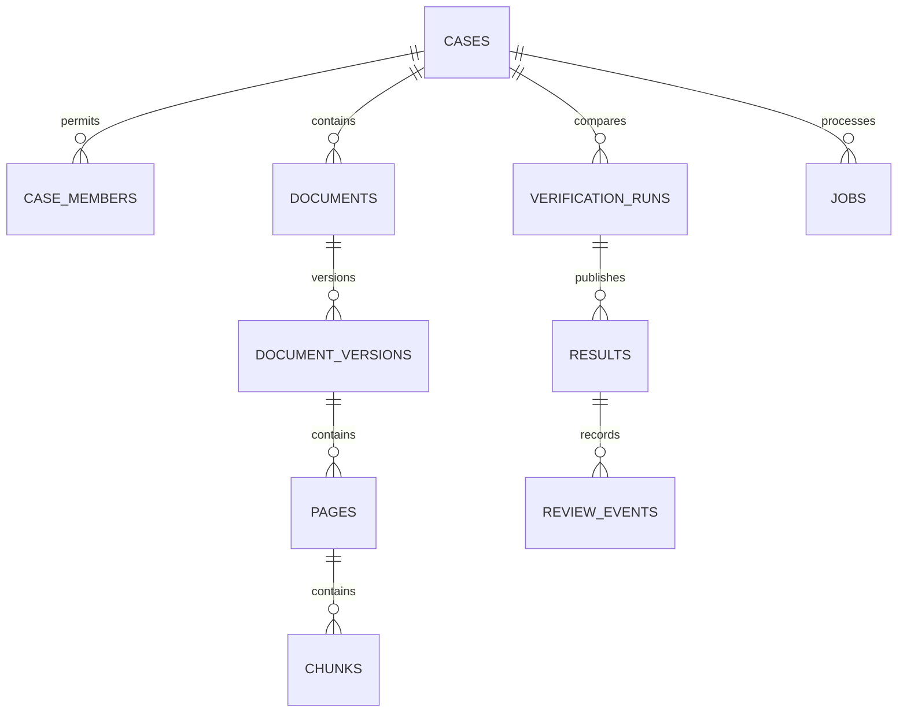

# Implementation decisions

Next.js owns the reviewer interface and Supabase sign-in. FastAPI owns the workflow, protected document grants, PDF reading and model calls. Supabase holds the private evidence bucket, identities, records and vector index. The chosen backend operates as one small web service with a durable Postgres queue. A serverless Edge-only design is less suitable for the native OCR worker. Locally hosted transformer models would require substantially more resources on the free service.

Run manifests freeze selected document versions, extraction identifiers, hashes and model settings. Structured inspection targets are persisted within result records. Exact citation objects carry the Unicode offsets, page numbers, original quotation and line boxes. Redis and a separate vector database would duplicate infrastructure. The checked-in OpenAPI contract generates frontend types.

Cross-document retrieval stays within one case and selected versions. A supported or contradicted claim needs a valid quotation and compatible scope. Date and asset differences trigger review. For absence claims, the second search examines the eligible corpus within a bounded prompt budget and records its coverage. Readability gaps prevent absence conclusions. The blind prompt supplies a second relation check using the same hosted model. It is vulnerable to correlated errors, which are evaluated separately from the application’s quote validation.

The API reads case records with the user’s Supabase token and writes through narrowly scoped server RPCs. The job worker holds the service credential and validates ownership, case scope and leases before writes. Storage keys use case and document IDs. Browser users receive a time-limited grant for the required object. The parser processes PDFs in page batches and checkpoints progress so later worker invocations can resume. Upload size follows the project Storage limit. A case can hold up to 10 distinct documents.

Jobs record stage and progress. A worker retry reuses cached model responses and persisted results. One result ID is derived per anchor and run. Only completed and partial snapshots can receive reviewer decisions. Decisions append events and survive later runs. A whole-case deletion removes stored PDFs, text, results and model cache owned by that case.

The local integration test uses scripted model outputs at the provider boundary. The running application invokes Gemini for extraction, retrieval and verification. Saved sample documents contain input records only.

## Decision log

- Hosted inference and one free web service were selected to suit the team's budget and stack.
- The NLI-style check uses a blind call with the configured Gemini model. A distinct pretrained NLI model is a future evaluation candidate.
- The expanded auditor workflow includes CAP linkage through explicit source references and asset identifiers. Reviewers can accept, dismiss, or record a manual link. CAP metadata and exact source anchors stay in the run snapshot. Link decisions append to a case-scoped history. Held-out evaluation remains a release gate.
- Free-tier latency, project quotas, model accuracy and the official revised schedule require confirmation.
