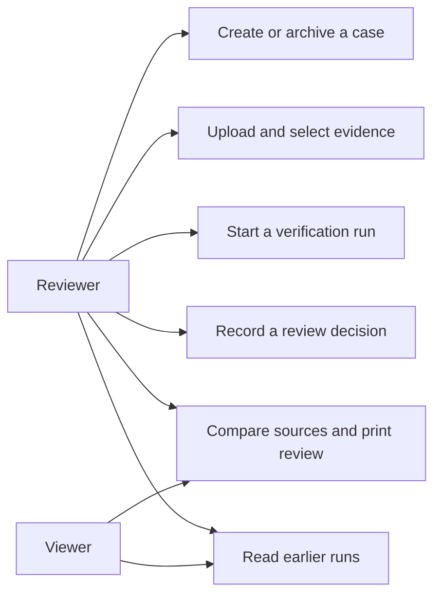

# Product and evidence

SafetyProof focuses on documentary review for a single garment factory per case. The selected proposal includes PDF and OCR reading, bilingual retrieval, structured extraction, verification against other documents, an NLI-style second opinion, and a reviewer’s accept/dismiss/comment actions. Its three flags are contradictions, unsupported claims and missing documented closure.

| Origin | Decision |
|---|---|
| Selected proposal | Deliver the three flags, page citations, bilingual evidence and human review |
| Post-selection enhancements | Implement auditor-led CAP matching with source citations and reviewer link decisions. Complete the accuracy gate before claiming evaluation readiness. Defer assignments, buyer access, automated re-verification, recurrence, photos and chat |
| Architecture recommendations | Preserve immutable run snapshots, exact anchors, scope checks, recorded search coverage, and append-only reviewer decisions |

| Research evidence | Product implication |
|---|---|
| Factories and company signatories develop CAPs and the RSC monitors implementation under its programme. [RSC key information](https://rsc-bd.org/key-information/) | A CAP is supporting evidence. Programme scope matters. |
| The April 2024 RSC publication distinguishes factory-reported corrections pending verification from corrections verified by RSC engineers. [RSC status definitions](https://rsc-bd.org/wp-content/uploads/2025/01/RSC-Monthly-Update-April-2024.pdf) | A factory self-report is shown with its origin. Official closure belongs to the relevant authority. |
| The Accord lists disclosures for covered factories in Bangladesh and publishes quarterly aggregate reports under its methodology from January 2026. [International Accord](https://internationalaccord.org/bangladesh-factories/) | A publication schedule does not establish the timing of an individual inspection. |
| DIFE follow-up guidance and Sedex SMETA are distinct processes. [ILO/DIFE manual](https://www.ilo.org/publications/manual-capacity-building-dife-inspectors-follow-preliminary-safety), [Sedex SMETA](https://www.sedex.com/solutions/smeta-audit/) | Store the inspection programme as context. Pilot users need to confirm programme-specific authority and documentary verification procedures. |
| Established tools support investigations, evidence collection and corrective actions. [SafetyCulture](https://help.safetyculture.com/005315), [DIGI CLIP](https://www.digiclip.io/analytics/) | Demonstrate bilingual verification, context and source inspection. Exact competitor parity is unverified. |

A reviewer creates a case, confirms the factory, selects a document role and the relevant reporting period, then uploads PDFs. The Documents screen shows OCR coverage and revision selection. The reviewer runs verification from the selected versions. The Review queue compares sources and captures the decision. Run history compares the document versions and source-matched outcomes in two snapshots. The overview keeps evidence requests visible across runs. The CAP screen links proposed actions to cited findings and records human decisions. A viewer can read permitted files and print reports. A case creator can archive or delete their case.

Screens show empty, loading, failed and processed states. Low-quality pages remain available for inspection. An English report and Bangla scan can be compared without replacing the quoted text with an English translation. The review sheet describes documentary evidence and flags pending investigation.
